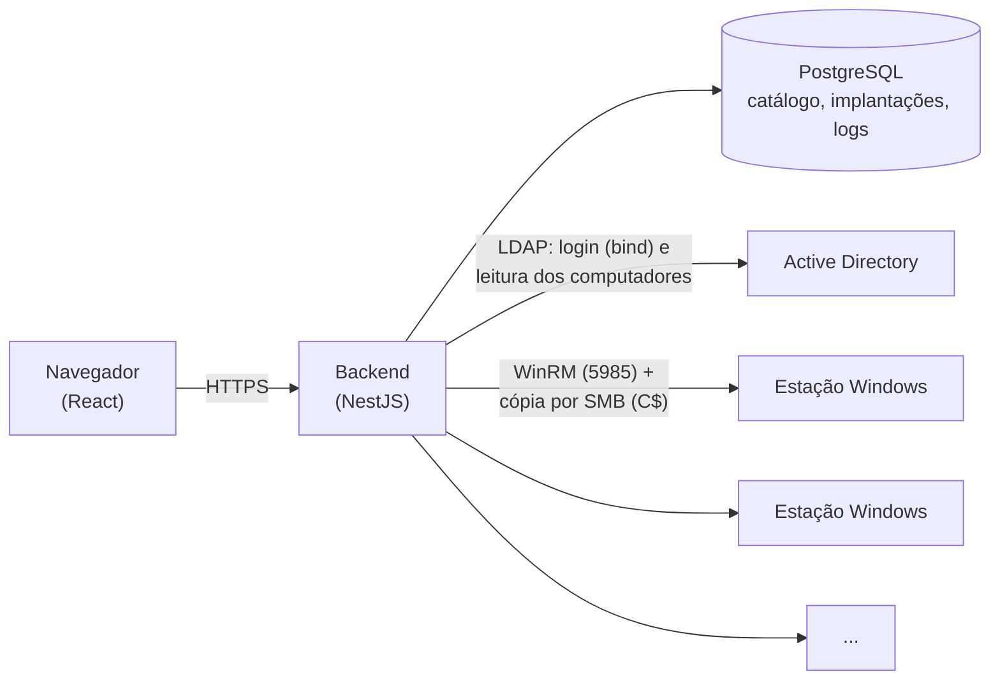
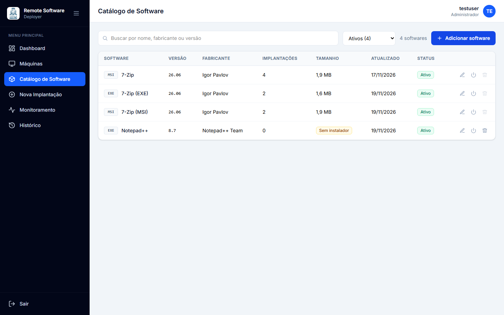
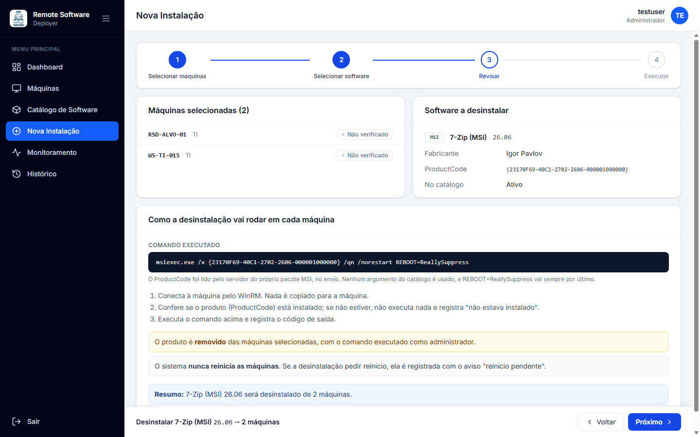

# Remote Software Deployer

[](https://github.com/rebecalara/remote-software-deployer/actions/workflows/ci.yml)
[](https://sonarcloud.io/summary/new_code?id=rebecalara_remote-software-deployer)
[](https://sonarcloud.io/summary/overall?id=rebecalara_remote-software-deployer)

Aplicação web para **implantação remota de software em estações Windows**, usando o
Active Directory (AD) como fonte das máquinas e o WinRM/PowerShell para executar a
instalação. Trabalho de Conclusão de Curso em Engenharia de Software, de Rebeca Lara de
Souza.


## O problema

O sistema nasceu de uma necessidade da equipe de TI da Prefeitura Municipal de
Joinville. Hoje, instalar um programa em muitas estações da rede é um trabalho manual,
máquina por máquina, ou depende de ferramentas que não cobrem todos os casos do dia a
dia.

O Remote Software Deployer centraliza esse trabalho num navegador:

1. o operador entra com a **mesma conta de rede** que já usa nos outros sistemas;
2. vê as estações cadastradas no AD, filtra e escolhe as máquinas de destino;
3. escolhe um software de um **catálogo controlado**, com o instalador guardado pelo
   próprio sistema;
4. acompanha a instalação em cada máquina, com o passo atual e o log;
5. consulta depois o histórico de tudo o que foi instalado, por quem e com qual
   resultado;
6. consulta, ao vivo, o software instalado numa máquina.

Nada precisa ser instalado antes nas estações: o sistema usa recursos que o Windows já
tem (WinRM e o compartilhamento administrativo).

## Arquitetura



- O **navegador** fala só com o backend. O token JWT de sessão vale 8 horas.
- O **backend** autentica no AD e sincroniza a lista de computadores (automaticamente e
  pelo botão "Sincronizar agora"). Também guarda os instaladores, executa as
  implantações numa fila (até 10 máquinas em paralelo) e grava o resultado e o log de
  cada máquina.
- Em cada estação, um **script PowerShell fixo** faz sempre a mesma sequência:
  1. copia o instalador;
  2. confere o hash;
  3. verifica se o produto já está instalado;
  4. executa em modo silencioso;
  5. apaga os arquivos temporários.

  Na **desinstalação** (só MSI), o mesmo script confere se o produto está instalado e
  executa `msiexec /x {ProductCode}`, sem copiar nada.
- Para alcançar as estações pelo WinRM, **o backend precisa rodar em Windows, dentro da
  rede das estações.**

### Stack

As versões são fixas de propósito: atualizações automáticas de versão principal já
quebraram o ambiente quatro vezes durante o projeto.

| Camada | Tecnologia |
|---|---|
| Frontend | React `19.3.0`, React Router `7.18.4`, Vite `7.3.6`, Tailwind CSS `4.3.3`, TypeScript `5.8.3` |
| Backend | Node.js `22.x` LTS, NestJS `11`, Prisma `5.22.0`, `ldapjs` 3, TypeScript `5.8.3`, Jest |
| Banco | PostgreSQL `18.6` |
| Diretório | Active Directory (produção) · OpenLDAP `2.4.57` em Docker, imagem `osixia/openldap` (desenvolvimento) |
| Execução remota | Windows PowerShell 5.1, WinRM e SMB |

Restrições conhecidas: Node 24 quebra o Prisma 5, o Prisma 6+ não tem os comandos
clássicos de migração, o NestJS 12 só publica ESM e o TypeScript 7 quebra o `ts-node`.

## Funcionalidades por requisito

| RF | Requisito | Situação |
|---|---|---|
| RF01 | Autenticação | ✅ Login com a conta de rede, por bind LDAP no AD. Perfis ADMIN, OPERATOR e VIEWER. |
| RF02 | Visualizar máquinas | ✅ Lista sincronizada com o AD, com nome, sistema operacional, setor (OU) e data da última confirmação no AD. Status "Respondendo no WinRM" / "Sem resposta", por verificação periódica da porta 5985 (só teste de conexão) e pelo botão "Verificar agora". |
| RF03 | Selecionar máquinas | ✅ Seleção individual e "selecionar todas" respeitando a busca e o filtro de setor. Até 50 máquinas por implantação, configurável em `DEPLOYMENT_MAX_MACHINES` (de 1 a 500). |
| RF04 | Cadastrar softwares | ✅ Catálogo com MSI e EXE e argumentos silenciosos. O instalador é enviado ao sistema, que calcula o SHA-256. Desativar em vez de apagar o que já foi implantado. |
| RF05 | Executar instalação remota | ✅ Fila com até 10 máquinas em paralelo e uma instalação por vez em cada máquina. Um pedido igual a uma implantação ainda pendente ou em andamento (mesma ação, mesmo software ou produto, alguma máquina em comum) é recusado, mesmo se os dois chegarem ao mesmo tempo. Validado numa VM de laboratório (ver [Limitações](#limitações-conhecidas)). |
| RF06 | Acompanhar status | ✅ Monitoramento com as implantações em andamento e as encerradas nas últimas 24 h. Cada uma expande na própria linha, com a fase de cada máquina (conectando, copiando, conferindo o hash, instalando…), atualizada a cada 3 s. |
| RF07 | Histórico de instalações | ✅ Implantações encerradas, com filtros por período, ação, status, software, máquina e "Minhas implantações", e paginação. Os filtros ficam no link. |
| RF08 | Inventário de software instalado por máquina | ✅ No painel da máquina: consulta ao vivo pelo WinRM, só de leitura, com nome, versão, fabricante, data de instalação e ProductCode. Os MSI do catálogo aparecem marcados, com atalho para desinstalar. A última consulta fica guardada, com data e quem consultou, e é refeita sozinha depois de cada implantação na máquina. |
| RF09 | Registrar resultado | ✅ Status e código de saída por máquina. Os códigos do Windows Installer (1603, 1618…) aparecem com mensagem explicativa. |
| RF10 | Mensagens de sucesso e falha | ✅ Cada falha diz a fase e o motivo (máquina não encontrada, WinRM recusado, acesso negado, hash diferente, tempo esgotado…). |
| RF11 | Pesquisar e filtrar máquinas | ✅ Busca por nome, sistema ou setor; filtro por setor e por presença no AD. |
| RF12 | Detalhes da máquina | ✅ Painel com os dados vindos do AD. IP, CPU e memória não são mostrados porque o AD não os fornece. |
| RF13 | Logs de execução | ✅ Log completo de cada máquina, com hora e nível, dentro da implantação expandida no Monitoramento e no Histórico. |

### Acréscimo fora do RFC: desinstalação remota (só MSI)

Na Nova Implantação, o passo do software tem a escolha **Instalar / Desinstalar**.

- **Como funciona:** a desinstalação usa o mesmo fluxo da instalação (fila, uma ação
  por vez em cada máquina, logs, Monitoramento, Histórico e permissões). Na máquina, o
  comando é sempre `msiexec.exe /x {ProductCode} /qn /norestart REBOOT=ReallySuppress`.
  **Nada é copiado** para a máquina, e nenhum argumento do catálogo é repassado.
- **O que pode ser desinstalado:** em "Desinstalar", o passo 2 lista **o software
  instalado nas máquinas selecionadas**, a partir do inventário guardado de cada uma
  (RF08), com quantas delas têm cada item.
  - **Qualquer MSI pode ser escolhido, inclusive fora do catálogo.**
  - Os itens que não são MSI só podem ser escolhidos pelo **comando do fabricante**
    (exceção controlada, logo abaixo); sem ele, aparecem desativados, com o motivo.
  - Máquinas sem inventário, ou com inventário de mais de 7 dias, geram um aviso e o
    botão "Consultar agora".
  - Aparece só o que o inventário encontrou, como no painel da máquina.
- **De onde vem o ProductCode:**
  - **MSI do catálogo:** é lido pelo servidor do próprio pacote, no envio, com o pacote
    aberto só para leitura.
  - **MSI fora do catálogo:** vem do inventário. A API só aceita um ProductCode que
    apareça no inventário guardado de pelo menos uma das máquinas selecionadas. O nome, a
    versão e o fabricante gravados na implantação vêm desse inventário, no servidor, e
    não do navegador.
- **Produto fora do catálogo:** a revisão mostra um aviso, e o passo 4 exige marcar
  "Confirmo que este produto pode ser removido". Monitoramento, Histórico (com o filtro
  "Fora do catálogo") e Dashboard mostram o nome do produto, e quem pediu continua
  registrado.
- **Produto ausente:** se o produto não estiver instalado na máquina, nada é executado e
  a máquina fica como sucesso, com o aviso "não estava instalado". O mesmo vale para o
  código 1605. Os códigos 0, 3010 e 1641 têm o mesmo tratamento da instalação.
- **Software desativado** no catálogo pode ser desinstalado; instalar continua exigindo
  software ativo.
- **Programas que não são MSI: exceção controlada, desligada por padrão.** Com
  `DEPLOYMENT_ALLOW_VENDOR_UNINSTALL="true"`, um programa que **declarou** no registro o
  seu comando silencioso de desinstalação (`QuietUninstallString`) pode ser desinstalado
  por ele. É a única exceção à regra "nunca executar comando que não seja do sistema":
  - o comando vem do inventário guardado, no servidor; o navegador só manda um
    identificador calculado pelo servidor;
  - o comando é validado no servidor e de novo na máquina, com as mesmas regras e os
    mesmos casos de teste. Ele precisa ter:
    - um **.exe com caminho absoluto dentro de Program Files ou Program Files (x86)**;
    - nada de `cmd`, `powershell`, `pwsh`, `wscript`, `cscript`, `mshta`,
      `rundll32`, `regsvr32`, `msiexec` e similares;
    - nada de caminho sem aspas com espaço, `..`, `~`, variáveis, `&`, `|`, `;` ou
      redirecionamento;
    - nenhuma junção ou link no caminho do executável;
  - na máquina, o comando relido do registro precisa ser **idêntico** ao do inventário;
    senão, nada é executado;
  - a execução é por `Start-Process`, sem `cmd`, com tempo limite;
  - **o sucesso é confirmado relendo o registro** (a chave do programa saiu), com
    espera de até 2 minutos, qualquer que seja o código de saída;
  - a assinatura digital do executável fica no log, sem bloquear;
  - a confirmação no passo 4 é sempre obrigatória;
  - o `UninstallString` (sem "Quiet") **nunca** é lido nem executado.

## Telas

| | |
|---|---|
| **Login** com a conta de rede<br/> | **Máquinas** sincronizadas com o AD, com o painel de detalhes<br/> |
| **Catálogo de Software**: tipo, tamanho e implantações<br/> | **Nova Implantação**, revisão com o comando exato que será executado<br/> |
| **Monitoramento**, com a implantação expandida na própria linha e o log da máquina<br/> | **Histórico** com filtros, uma implantação parcial expandida<br/> |
| **Desinstalação** (só MSI), revisão com o comando exato<br/> | **Software instalado** na máquina (RF08), consultado ao vivo<br/> |
| **Desinstalação pelo inventário**: MSI fora do catálogo, em quantas máquinas está, "Consultar agora"<br/> | |

Os prints foram feitos no ambiente de desenvolvimento, só com dados fictícios: as
máquinas `WS-*` vêm do OpenLDAP local, e a `RSD-ALVO-01` é uma VM de laboratório. O
Monitoramento mostra uma desinstalação real nessa VM, e o Histórico, uma instalação em
que a VM concluiu e a outra máquina, fictícia, falhou por não existir na rede.

## Decisões de segurança

- **Nenhuma senha armazenada.** O login é exclusivamente por bind no AD. O sistema não
  tem cadastro de senha, e a senha digitada é usada só para o bind e descartada. O perfil
  de acesso (ADMIN, OPERATOR ou VIEWER) vem do banco do sistema: só entra quem foi
  cadastrado.
- **Token de sessão.** O JWT é assinado e verificado só em HS256 (um token em outro
  algoritmo, inclusive `none`, é recusado). O backend não sobe sem `JWT_SECRET` com pelo
  menos 32 caracteres.
- **Login no AD.** O usuário não diferencia maiúsculas ("Rebeca" = "rebeca"): é convertido
  para minúsculas antes do bind e da consulta à tabela `User`, onde fica sempre em
  minúsculas. Só letras sem acento, dígitos, `.`, `_` e `-` (e `@`, quando a pessoa digita
  o UPN inteiro); fora disso, a mensagem é a mesma de senha errada, sem consultar o AD —
  nada que mude o DN do bind chega ao LDAP. Em produção, `ldaps://` (porta 636), com o
  certificado sempre verificado; se a CA for interna, ela é confiada por
  `NODE_EXTRA_CA_CERTS`. Com `ldap://` para outro servidor, o backend avisa na subida que as
  senhas trafegam sem criptografia.
- **Limite de tentativas de login:** no máximo 5 por IP em 15 minutos; a sexta recebe 429,
  com o tempo de espera, sem chegar ao AD. Protege contra força bruta e contra o bloqueio
  das contas no AD. Não contam o login com sucesso nem o AD fora do ar, que responde 503
  ("serviço de autenticação indisponível"). Atrás do Caddy, o IP vem do
  `X-Forwarded-For`, aceito só quando a conexão chega de 127.0.0.1 (o próprio Caddy); de
  qualquer outro endereço o cabeçalho é ignorado, porque seria falsificável.
- **Nenhuma execução arbitrária.** O script de instalação é fixo e versionado
  ([`backend/scripts/deploy-target.ps1`](backend/scripts/deploy-target.ps1)), nunca
  montado como texto.
  - Os parâmetros chegam pela entrada padrão, em JSON, e não pela linha de comando, que
    ficaria visível na lista de processos.
  - Os argumentos do catálogo são tokens validados por uma lista de caracteres
    permitidos e passados como parâmetros (`Start-Process -ArgumentList`), nunca por
    `Invoke-Expression` ou `cmd /c`.
  - Não existe o tipo "script".
  - Na desinstalação, o comando também é fixo (`msiexec /x {ProductCode}`). O
    ProductCode vem do próprio pacote MSI, lido no servidor por outro script fixo
    ([`backend/scripts/read-msi-info.ps1`](backend/scripts/read-msi-info.ps1)) que abre
    o MSI só para leitura, ou do inventário guardado das máquinas selecionadas. Nenhum
    argumento do catálogo é usado, e o `UninstallString` do registro nunca é executado.
  - **Exceção controlada:** um programa que não é MSI pode ser desinstalado pelo comando
    silencioso que ele mesmo declarou (`QuietUninstallString`), com a opção ligada
    (desligada por padrão). O comando é validado por regras fixas
    ([`backend/scripts/uninstall-command-rules.ps1`](backend/scripts/uninstall-command-rules.ps1),
    com os casos em [`uninstall-command-cases.json`](backend/scripts/uninstall-command-cases.json))
    e executado por outro script fixo
    ([`backend/scripts/uninstall-program-target.ps1`](backend/scripts/uninstall-program-target.ps1)).
    Detalhes na seção de desinstalação, acima.
- **O sistema não reinicia as máquinas; no MSI, isso é garantido.** O MSI roda com `/norestart`, e
  `REBOOT=ReallySuppress` é sempre o último argumento, na instalação e na desinstalação. O catálogo recusa `REBOOT` com
  outro valor. Isso foi encontrado na prática: na VM de teste, um `REBOOT=Force` vindo
  do catálogo reiniciou a máquina antes dessa proteção existir. Um instalador EXE pode
  reiniciar por conta própria (ver [Limitações conhecidas](#limitações-conhecidas)); a tela
  Revisar avisa isso.
- **Pasta temporária protegida.** Na estação, o instalador fica em `C:\ProgramData\RSD\<alvo>`,
  criada pela sessão WinRM já com permissão só para SYSTEM e Administradores, sem herança
  ([`backend/scripts/temp-dir-rules.ps1`](backend/scripts/temp-dir-rules.ps1)). Antes de usar, a
  pasta-base é conferida (dono, herança, permissões, junção): se um usuário comum a tiver
  pré-criado, nada é copiado nem executado. Usuário comum não consegue plantar arquivos (ex.:
  uma DLL) ao lado do instalador, que roda como administrador.
- **Hash conferido no destino.** O SHA-256 é calculado pelo servidor no envio do
  instalador e conferido na própria estação antes de executar. Se não bater, nada é
  executado e a cópia é apagada.
- **Conta de serviço, nunca a do usuário.** A instalação é executada por uma conta de
  serviço dedicada, administradora local das estações. Em produção, o backend roda como
  serviço do Windows sob uma **conta de serviço gerenciada (gMSA)**, e o WinRM usa a
  identidade do processo via Kerberos, sem senha em arquivo. Quem *pediu* a implantação
  fica registrado.
- **Inventário só de leitura.** A consulta do software instalado (RF08) usa outro script
  fixo ([`backend/scripts/inventory-target.ps1`](backend/scripts/inventory-target.ps1)),
  que só lê as chaves Uninstall do registro, de 64 e 32 bits.
  - Na máquina, nada é copiado e nenhum processo é iniciado.
  - **Nunca `Win32_Product`:** consultar essa classe faz o Windows Installer verificar e
    reparar cada MSI instalado.
  - No teste com a VM, a consulta não gerou nenhum evento do Windows Installer.
- **Permissões por perfil no backend.** Toda rota exige o token JWT. Implantar,
  cancelar, alterar o catálogo e consultar o software instalado ao vivo exigem ADMIN ou
  OPERATOR. O VIEWER só consulta, inclusive a última lista de software guardada.
- **Auditoria.** O sistema registra quem cadastrou e quem alterou cada software, quem
  pediu e quem cancelou cada implantação, e o log de cada máquina.
- **Segredos fora do repositório.** Só os `.env.example` são versionados. Os dados de
  `docker/ldap/` são fictícios e valem apenas no container local.

## Como rodar localmente

### Pré-requisitos

- **Node.js 22.x**, de preferência via `nvm`. Não use o Node 24.
- **Docker** (Docker Desktop no Windows).
- **Git Bash** ou outro shell `sh`, para o script de preparação do LDAP.
- **Windows**, apenas para executar implantações. O resto do sistema funciona em
  qualquer sistema operacional; fora do Windows, a tela mostra a implantação como
  indisponível.

### 1. Banco e AD fictício (Docker)

```bash
# PostgreSQL
docker run --name rsd-db -e POSTGRES_PASSWORD=<escolha-uma-senha> \
  -e POSTGRES_DB=remote_software_deployer -p 5432:5432 -d postgres:18.6

# OpenLDAP simulando o AD (slapd 2.4.57). A imagem é fixada pelo digest porque a tag
# "latest" usada no desenvolvimento não é a mesma build da tag "1.5.0".
docker run --name openldap-dev -e LDAP_ORGANISATION="RSD Dev" -e LDAP_DOMAIN=rsd.local \
  -e LDAP_ADMIN_PASSWORD=<escolha-uma-senha> -p 389:389 -p 636:636 \
  -d osixia/openldap@sha256:3f68751292b43564a2586fc29fb7337573e2dad692b92d4e78e49ad5c22e567b

# Espere alguns segundos o LDAP subir e aplique os dados fictícios
# (conta de serviço de leitura, 16 computadores em 7 setores, usuários de teste e ACL).
# Pode rodar de novo sem duplicar nada.
sh docker/ldap/setup-dev.sh
```

### 2. Backend

```bash
cd backend
npm ci
cp .env.example .env
```

Preencha o `backend/.env`. Para o ambiente local, os valores são:

| Variável | Valor em desenvolvimento |
|---|---|
| `DATABASE_URL` | `postgresql://postgres:<senha-do-rsd-db>@127.0.0.1:5432/remote_software_deployer?schema=public` |
| `LDAP_URL` | `ldap://127.0.0.1:389` |
| `LDAP_BIND_DN_TEMPLATE` | `uid={{username}},ou=people,dc=rsd,dc=local` |
| `LDAP_SEARCH_BIND_DN` | `uid=svc-rsd-leitura,ou=services,dc=rsd,dc=local` |
| `LDAP_SEARCH_BIND_PASSWORD` | senha fictícia definida em `docker/ldap/services.dev.ldif` |
| `LDAP_COMPUTER_BASE_DN` | `ou=computers,dc=rsd,dc=local` |
| `LDAP_COMPUTER_FILTER` | `(objectClass=device)` |
| `LDAP_COMPUTER_OS_ATTRIBUTE` | `description` |
| `INSTALLER_STORAGE_DIR` | uma pasta **fora do repositório e fora do OneDrive**, entre aspas simples. Exemplo: `'C:\rsd-data\installers'`. O sistema recusa as duas localizações. |
| `JWT_SECRET` | obrigatório, no mínimo 32 caracteres (o backend não sobe sem ele). Gere com: `node -e "console.log(require('crypto').randomBytes(48).toString('base64url'))"` |

**LDAP com TLS (AD real, produção):** use `LDAP_URL="ldaps://servidor:636"`. O certificado do
AD é sempre verificado. Se ele for emitido pela CA interna da Prefeitura, exporte a CA em PEM e
defina, no ambiente do processo do backend (não no `.env`: o Node só lê essa variável na
partida), `NODE_EXTRA_CA_CERTS=C:\caminho\ca-interna.pem`. O nome no certificado precisa
bater com o servidor do `LDAP_URL`. Com `ldap://` para um endereço que não seja
`127.0.0.1`/`localhost`, o backend registra na subida: "as senhas trafegam sem criptografia;
use ldaps://". O OpenLDAP local continua em `ldap://127.0.0.1:389`.

Use `127.0.0.1`, e não `localhost`, no banco e no LDAP: no Windows, `localhost` pode ir primeiro
para o IPv6 `::1`, onde outro programa (ex.: o `wslrelay` do WSL) aceita a conexão e não responde
— o backend fica esperando e não sobe.

As demais variáveis já têm padrão e estão comentadas no próprio `.env.example`. Entre elas,
`DEPLOYMENT_MAX_MACHINES` (máximo de máquinas numa implantação, padrão 50, de 1 a 500): a
tela da Nova Implantação lê o valor do backend, então basta mudar no `.env` e reiniciar.

Depois, aplique as migrations, cadastre os usuários de teste e suba o backend:

```bash
npm run db:generate
npm run db:deploy

# Usuários de teste: o login vem do LDAP; o perfil, da tabela User do sistema.
# O username vai SEMPRE em minúsculas (o login converte o que a pessoa digita).
docker exec -i rsd-db psql -U postgres -d remote_software_deployer <<'SQL'
INSERT INTO "User" (id, username, "displayName", role)
VALUES (gen_random_uuid(), 'testuser', '', 'ADMIN') ON CONFLICT (username) DO NOTHING;
INSERT INTO "User" (id, username, "displayName", role)
VALUES (gen_random_uuid(), 'viewer', 'Usuário Visualizador', 'VIEWER') ON CONFLICT (username) DO NOTHING;
SQL

npm run start:dev      # http://127.0.0.1:3000 (GET /health)
```

### 3. Frontend

```bash
cd frontend
npm ci
cp .env.example .env
npm run dev            # http://localhost:5173
```

O Vite repassa as chamadas `/api` para o backend na porta 3000. Usuários de teste (senhas
fictícias, que só valem no container local):

| Usuário | Senha | Perfil |
|---|---|---|
| `testuser` | `senha123` | ADMIN |
| `viewer` | `viewer-dev-123` | VIEWER (somente leitura) |

### 4. Testes

```bash
cd backend
npm test               # Jest: testes automatizados do backend
npm run test:cov       # o mesmo, com relatório de cobertura em backend/coverage

cd ../frontend
npm test               # Vitest + Testing Library (navegador simulado pelo jsdom)
npm run test:cov       # com relatório de cobertura em frontend/coverage
```

### 5. VM de teste (opcional, para implantar de verdade)

Sem uma máquina Windows com WinRM, todo o resto funciona: as implantações em máquinas
fictícias falham com "máquina não encontrada", como devem. Para ver uma instalação real:

1. Crie uma VM Windows no Hyper-V (a de Avaliação serve) e dê a ela um nome que exista
   no LDAP fictício: `rsd-alvo-01` já está em `docker/ldap/computers.dev.ldif`.
2. **Na VM**, como administrador:
   - crie uma conta local administradora (exemplo: `rsd-deploy`);
   - rode `Enable-PSRemoting -Force`;
   - libere no firewall o "Compartilhamento de Arquivos e Impressoras";
   - defina `LocalAccountTokenFilterPolicy = 1` em
     `HKLM\SOFTWARE\Microsoft\Windows\CurrentVersion\Policies\System`. Sem isso, uma
     conta administradora local não usa o `C$` nem o WinRM com privilégio total.
3. **No computador do backend**, como administrador:
   - inicie o serviço WinRM;
   - inclua a VM no `TrustedHosts`: `Set-Item WSMan:\localhost\Client\TrustedHosts -Value <nome-da-VM>`.

   Isso só é necessário porque a VM está fora de domínio. Num domínio, o Kerberos
   dispensa esse passo.
4. No `backend/.env`, preencha `WINRM_USERNAME='<nome-da-VM>\rsd-deploy'` e
   `WINRM_PASSWORD`. Reinicie o backend e clique em "Sincronizar agora" na tela de
   Máquinas.

Recomenda-se um checkpoint da VM limpa: cada teste deixa o software instalado.

## Integração contínua

O GitHub Actions (`.github/workflows/ci.yml`) roda a cada push e pull request em `dev` e
`main`, e também manualmente:

1. **Backend e frontend, em paralelo:** `npm ci`, testes com cobertura
   (`npm run test:cov`), build e o `lcov.info` guardado como artefato. No backend, também o
   `prisma generate`. No Linux do CI, os testes que chamam o `powershell.exe` de verdade são
   pulados.
2. **SonarCloud**, depois dos dois: análise estática e a cobertura dos dois lados. Sem o
   token (PR de fork), a análise é pulada.
3. **Deploy**, só em push na `main` e depois do backend e do frontend passarem: ver
   [Deploy em produção](#deploy-em-produção).

Um teste ou build que falha deixa o job vermelho (e, na `main`, não há deploy). O Quality Gate
aparece no SonarCloud e no badge, mas não bloqueia o pipeline: a regra padrão pede 80% de
cobertura no código novo, e o frontend está em ~32%. A regra será revista depois da release.

## Deploy em produção

A `main` vai para produção sozinha: cada push nela (o merge de um PR, já que a `main` é
protegida) roda os testes e, se passarem, o job **deploy** publica a versão na VM **APP-RSD**
(Windows Server 2022, no domínio), atrás do Caddy (HTTPS). Não há deploy manual. O histórico
de cada publicação fica no GitHub, em *Deployments* → `production`.

### Preparo × deploy

| | Preparo da VM | Deploy |
|---|---|---|
| Script | [`deploy/provision-app.ps1`](deploy/provision-app.ps1) | [`deploy/deploy.ps1`](deploy/deploy.ps1) |
| Quem roda | administrador, à mão, uma vez (pode rodar de novo: só confere e completa) | o GitHub Actions, a cada push na `main` |
| Com que conta | administrador | `rsd-runner` (conta local, sem administração) |
| O que faz | Node, Git e PostgreSQL nas versões exatas (hash e assinatura conferidos); banco e papéis; pastas e permissões; serviço `rsd-backend`; Caddyfile; runner | build do backend, backup, migrações, troca de versão, health check, rollback |

**Contas e papéis**, cada um com o mínimo:

- `RSDDEMO\svc-rsd` roda o backend (serviço `rsd-backend`, pelo [WinSW](deploy/rsd-backend.xml)) e é
  a identidade do WinRM nas estações. Lê `C:\rsd\config\backend.env` e grava os instaladores.
- `rsd-runner` roda o runner do GitHub Actions. Grava só em `C:\rsd\app`, nos backups e nos logs;
  lê só o `C:\rsd\config\deploy.env`; consulta, inicia e para **só** o serviço do RSD. Não tem
  logon local, por RDP nem pela rede, e não enxerga os instaladores nem o `backend.env`.
- No banco, `rsd_owner` faz as migrações (credencial no `deploy.env`) e `rsd_app`, o do backend,
  só lê e grava dados (no `backend.env`). As tabelas que as migrações criarem já nascem com as
  permissões do `rsd_app` (`ALTER DEFAULT PRIVILEGES`, no preparo).

Nenhum segredo fica no repositório: as senhas são geradas na própria VM (banco) ou digitadas
na hora (conta do serviço, token do runner) e não são guardadas em arquivo.

### O que acontece em cada deploy

1. **Versão nova** em `C:\rsd\app\releases\<data>-<sha7>`: o backend é compilado na VM (`npm ci`,
   `prisma generate`, `nest build` — o motor do Prisma precisa ser o do Windows); o frontend é o
   build que passou nos testes do CI.
2. **Backup** do banco (`pg_dump`) em `C:\rsd\data\backups\rsd-antes-deploy-<data>-<sha7>.dump`.
3. **Migrações** (`prisma migrate deploy`). Se falharem, o deploy para e a versão no ar
   continua a mesma.
4. **Permissões do `rsd_app`** conferidas em todas as tabelas e sequências. Se faltar alguma, o
   deploy para sem trocar a versão.
5. **Troca:** o serviço para, `C:\rsd\app\current` (uma junção) passa a apontar para a versão nova,
   o serviço sobe e `http://127.0.0.1:3000/health` tem de responder `{ "status": "ok" }` em até 60 s.
6. **Site pelo Caddy:** confere `https://<domínio>/` e `/api/health`. De dentro da VM, o domínio
   público pode não responder (rede do Azure); aí confere pelo Caddy local. Isso só gera aviso:
   quem decide o rollback é o health check do backend.
7. **Limpeza:** ficam as últimas 5 versões e os últimos 10 backups de deploy. Os instaladores
   (`C:\rsd\data\installers`) nunca são tocados.

### Rollback

**Automático:** se o backend não passar no health check depois da troca (ou nem subir), o deploy
volta sozinho para a versão anterior, confere de novo e termina com o job vermelho, explicando
o que aconteceu no resumo do job.

**O rollback volta o código, não o banco.** Se a migração já rodou, a versão anterior passa a
rodar sobre o schema novo. Isso é seguro porque as migrações do RSD **só acrescentam** (coluna
nova opcional, índice, restrição que os dados já cumprem). Regra para o futuro: apagar ou
renomear algo vai em duas releases — primeiro a versão que para de usar, depois a migração que
remove.

**Voltar uma versão à mão**, na APP-RSD, como administrador:

```powershell
.\deploy\rollback.ps1 -List          # versões guardadas (* = no ar)
.\deploy\rollback.ps1                # volta para a anterior à que está no ar
.\deploy\rollback.ps1 -To 1a2b3c4    # para uma versão pelo SHA do commit
```

Também dá para repetir o deploy de um commit antigo pelo GitHub (*Actions* → a execução daquele
commit → *Re-run jobs*): ele refaz o build daquele commit, e as migrações já aplicadas são
ignoradas.

**Restaurar o banco** (só se uma migração tiver estragado dados — apaga o que foi gravado
depois do backup):

```powershell
Stop-Service rsd-backend
& 'C:\Program Files\PostgreSQL\18\bin\pg_restore.exe' --clean --if-exists --no-owner `
  --role=rsd_owner --host 127.0.0.1 --username rsd_owner --dbname rsd `
  'C:\rsd\data\backups\rsd-antes-deploy-<data>-<sha7>.dump'
.\deploy\rollback.ps1 -To <sha da versão que combinava com esse banco>
```

Depois do primeiro deploy (e quando quiser conferir), `.\deploy\check-db-grants.ps1` prova, como
`rsd_app` e sem mudar nenhuma linha, que o backend lê e grava em todas as tabelas.

### Runner self-hosted num repositório público

O runner roda na própria APP-RSD. O risco: num pull request, o workflow que roda é o da branch
do PR, e alguém de fora poderia tentar usar o runner para rodar código na VM. Mitigações:

- **Settings → Actions → General → "Require approval for all external contributors"**:
  nenhum workflow de quem não é colaborador roda sem aprovação.
- A `main` é protegida (PR obrigatório, checks do backend e do frontend), e o environment
  `production` só aceita a `main`.
- O único job self-hosted roda só em push na `main`, com labels próprias (`rsd-app`); os
  outros jobs rodam no Ubuntu do GitHub.
- O `rsd-runner` não é administrador, não lê os instaladores nem os segredos do backend e
  controla só o serviço do RSD. O job não usa nenhum secret do GitHub.

O que continua: quem tem permissão de escrita no repositório (os colegas do PAC) roda
workflows sem aprovação. A confiança nesses colaboradores é o limite; eliminar isso por
completo exigiria um repositório privado ou uma organização com grupos de runners restritos.

### Caddy

O [`deploy/Caddyfile`](deploy/Caddyfile) é versionado, mas **não** é aplicado pelo deploy: o Caddy
roda como SYSTEM, e dar ao runner permissão no Caddyfile seria dar a ele um caminho para ler
qualquer arquivo. Quem aplica (com `caddy validate` antes e `caddy reload`, voltando o anterior
se falhar) é o `provision-app.ps1`, rodado por administrador.

## Limitações conhecidas

- **Validação na rede real pendente.** O login (bind) já foi testado no AD real com uma
  conta comum. A leitura e sincronização dos computadores (OUs com acento, mais de 1000
  objetos, conta de serviço da infraestrutura) e a implantação em estações reais dependem
  de acesso à rede da Prefeitura. A implantação foi validada de ponta a ponta numa VM de
  laboratório: MSI, EXE, "já instalado", hash adulterado, tempo esgotado, acesso negado e
  máquina inalcançável.
- **A hospedagem em nuvem é só demonstração.** O WinRM e o SMB das estações não são, e
  não devem ser, expostos à internet. Um servidor em nuvem mostra as telas com o AD
  fictício e a implantação indisponível. Em produção, o backend roda num servidor
  Windows dentro da rede da Prefeitura.
- **Banda:** cada máquina recebe uma cópia do instalador a partir do servidor. Por
  exemplo, 10 máquinas com um instalador de 300 MB somam 3 GB saindo do servidor.
- **"Respondendo no WinRM" não é "online":** a verificação periódica (a cada 15 min, e pelo
  botão "Verificar agora") só testa se a porta 5985 aceita conexão, sem autenticação e
  sem comando. Uma máquina que responde pode ainda recusar a credencial ou estar ocupada,
  e uma que não responde pode estar ligada com o firewall fechando a porta. Nomes que não
  existem no DNS levam ~2,7 s cada para falhar no Windows; para não travar o DNS do resto
  do backend, a verificação faz no máximo 2 consultas de DNS ao mesmo tempo, o que deixa a
  rodada mais lenta quando há muitos nomes antigos no AD. Sem WinRM no servidor (modo
  demonstração), a verificação fica desligada.
- **EXE sem verificação de "já instalado":** só o MSI traz um código de produto
  confiável. Um EXE implantado de novo é executado de novo.
- **Desinstalação só para MSI, e por versão:** cada ProductCode corresponde a uma
  versão do produto. Pelo inventário dá para escolher a versão que está de fato
  instalada. Uma máquina sem inventário, ou com inventário desatualizado, pode ter outra
  versão, e nesse caso o resultado é "não estava instalado".
- **Comando do fabricante (exceção controlada):**
  - **é código do fabricante rodando como administrador.** As regras impedem
    ferramentas do sistema e pastas onde um usuário comum consegue gravar, mas não dizem
    se o desinstalador é confiável. A assinatura fica só registrada, porque muitos
    desinstaladores não são assinados; o do 7-Zip, por exemplo, não é;
  - **pode reiniciar a máquina,** e o sistema não tem como impedir;
  - **um desinstalador que pede confirmação** trava, porque ninguém vê a janela, até o
    tempo limite. Se ele já tiver se copiado para a pasta temporária, o processo filho
    pode continuar na máquina;
  - **o sucesso é pelo registro:** a chave pode sair e deixar arquivos para trás, ou um
    desinstalador ruim pode tirar a chave sem remover o programa.
- **Produto fora do catálogo:** o sistema confere o ProductCode, mas não tem como saber
  se o produto é crítico (antivírus, agente de gerenciamento, biblioteca de outro
  programa). Por isso o aviso e a confirmação obrigatória.
- **Inventário:**
  - **é uma foto:** a lista mostra o momento da consulta, com data e quem consultou. Depois
    de cada implantação que pode ter mudado a máquina, o sistema refaz a consulta sozinho,
    em segundo plano; se ela falhar, a foto anterior continua;
  - **programas instalados só para um usuário não aparecem:** eles ficam no perfil
    desse usuário, e a sessão WinRM roda com a conta de serviço;
  - **a marcação "no catálogo" vale só para MSI,** pelo ProductCode. Um EXE não tem
    como ser comparado com segurança.
- **Um EXE pode reiniciar a máquina por conta própria.** O sistema controla o reinício
  do MSI, mas não o de um instalador EXE que o force internamente.
- **Fila e agendamento em memória, num único processo.** Com mais de uma instância do
  backend, a trava e a fila precisariam ir para o banco (por exemplo,
  `pg_advisory_lock`).
- Cancelamento só das máquinas ainda na fila: interromper uma instalação em curso
  poderia deixar a máquina em estado inconsistente.

## Trabalhos futuros

- **Busca por software em todas as máquinas** ("em quais máquinas está o X?"): exigiria
  guardar o inventário item a item, e não só a última foto de cada máquina.
- **Desinstalação de EXE:** exigiria descobrir, por família de instalador (Inno Setup,
  NSIS, InstallShield…), o desinstalador e os argumentos silenciosos de cada produto.
- **Agente nas estações:** eliminaria a cópia pelo servidor, que limita a banda, e
  permitiria saber se a máquina está ligada (não só se a porta do WinRM responde).
- **Dados de hardware** (IP, CPU, memória) por verificação sob demanda.
- **Implantação em ambiente demonstrável** para a banca: nuvem com o AD fictício e a
  implantação ao vivo pelo notebook com a VM.
- **Sessão em cookie `httpOnly`** em vez de `sessionStorage`.
- **Integração contínua** (lint e testes) no GitHub Actions.
