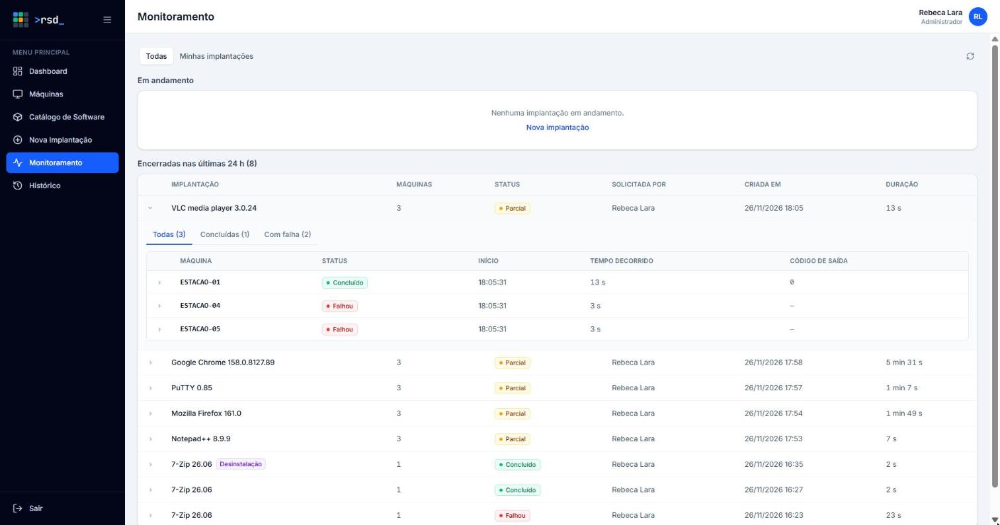
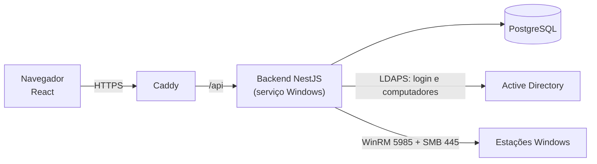

# Remote Software Deployer

[](https://github.com/rebecalara/remote-software-deployer/actions/workflows/ci.yml)
[](https://sonarcloud.io/summary/new_code?id=rebecalara_remote-software-deployer)
[](https://sonarcloud.io/summary/overall?id=rebecalara_remote-software-deployer)

Instalar um programa em muitas estações Windows de uma rede ainda é, em muitas equipes de TI,
um trabalho manual, máquina a máquina. O **Remote Software Deployer (RSD)** centraliza esse
trabalho num navegador: o técnico entra com a própria conta de rede, escolhe as máquinas
(sincronizadas com o Active Directory) e um software de um catálogo controlado, acompanha a
instalação em cada máquina e consulta o histórico e o software instalado. Nada é instalado
antes nas estações: o sistema usa o WinRM e o compartilhamento administrativo que o Windows
já tem. Trabalho de Conclusão de Curso em Engenharia de Software.

**Demonstração:** <https://rsd-demo-rebeca.chilecentral.cloudapp.azure.com> (ambiente na Azure,
com AD e estação de teste fictícios, implantando de verdade) · **Documentação:**
[Wiki](https://github.com/rebecalara/remote-software-deployer/wiki)

| | |
|---|---|
| **Dashboard**<br/> | **Nova Implantação**, revisão com o comando exato<br/> |
| **Monitoramento**, com a fase de cada máquina<br/> | **Software instalado** na máquina, consultado ao vivo<br/> |

As outras telas estão no [Guia de Uso](https://github.com/rebecalara/remote-software-deployer/wiki/Guia-de-Uso).

**Stack:** React 19 + Vite 7 + Tailwind 4 · NestJS 11 + Prisma 5.22 + PostgreSQL 18 · Active
Directory (LDAP/LDAPS) · Windows PowerShell 5.1, WinRM e SMB · Caddy · GitHub Actions,
SonarCloud e New Relic.



Detalhes em [Arquitetura](https://github.com/rebecalara/remote-software-deployer/wiki/Arquitetura).

## Como rodar localmente

O essencial para subir o sistema com dados fictícios. O passo a passo completo, o preparo de um
servidor e o deploy estão em
[Instalação e Deploy](https://github.com/rebecalara/remote-software-deployer/wiki/Instalacao-e-Deploy).

**Pré-requisitos:** Node.js 22.x (não use o 24, que quebra o Prisma 5), Docker e um shell `sh`.
A implantação de verdade só funciona com o backend no Windows; em outro sistema, o resto
funciona e a implantação aparece como indisponível.

**1. Banco e AD fictício (Docker)**

```bash
docker run --name rsd-db -e POSTGRES_PASSWORD=<escolha-uma-senha> \
  -e POSTGRES_DB=remote_software_deployer -p 5432:5432 -d postgres:18.6

# OpenLDAP simulando o AD; imagem fixada pelo digest
docker run --name openldap-dev -e LDAP_ORGANISATION="RSD Dev" -e LDAP_DOMAIN=rsd.local \
  -e LDAP_ADMIN_PASSWORD=<escolha-uma-senha> -p 389:389 -p 636:636 \
  -d osixia/openldap@sha256:3f68751292b43564a2586fc29fb7337573e2dad692b92d4e78e49ad5c22e567b

# Dados fictícios: conta de serviço de leitura, 16 computadores, usuários de teste e ACL
sh docker/ldap/setup-dev.sh
```

**2. Backend**

```bash
cd backend
npm ci
cp .env.example .env    # preencha conforme a tabela abaixo
npm run db:generate
npm run db:deploy

# Usuários de teste (o perfil vem da tabela User; o username sempre em minúsculas)
docker exec -i rsd-db psql -U postgres -d remote_software_deployer <<'SQL'
INSERT INTO "User" (id, username, "displayName", role)
VALUES (gen_random_uuid(), 'testuser', '', 'ADMIN') ON CONFLICT (username) DO NOTHING;
INSERT INTO "User" (id, username, "displayName", role)
VALUES (gen_random_uuid(), 'viewer', 'Usuário Visualizador', 'VIEWER') ON CONFLICT (username) DO NOTHING;
SQL

npm run start:dev       # http://127.0.0.1:3000/health
```

| Variável | Valor em desenvolvimento |
|---|---|
| `DATABASE_URL` | `postgresql://postgres:<senha-do-rsd-db>@127.0.0.1:5432/remote_software_deployer?schema=public` |
| `LDAP_URL` | `ldap://127.0.0.1:389` |
| `LDAP_BIND_DN_TEMPLATE` | `uid={{username}},ou=people,dc=rsd,dc=local` |
| `LDAP_SEARCH_BIND_DN` | `uid=svc-rsd-leitura,ou=services,dc=rsd,dc=local` |
| `LDAP_SEARCH_BIND_PASSWORD` | a senha fictícia de `docker/ldap/services.dev.ldif` |
| `LDAP_COMPUTER_BASE_DN` / `LDAP_COMPUTER_FILTER` / `LDAP_COMPUTER_OS_ATTRIBUTE` | `ou=computers,dc=rsd,dc=local` / `(objectClass=device)` / `description` |
| `INSTALLER_STORAGE_DIR` | uma pasta **fora do repositório e do OneDrive**, entre aspas simples (ex.: `'C:\rsd-data\installers'`) |
| `JWT_SECRET` | no mínimo 32 caracteres: `node -e "console.log(require('crypto').randomBytes(48).toString('base64url'))"` |

Use `127.0.0.1`, e não `localhost`: no Windows, `localhost` pode ir primeiro para o IPv6 `::1`,
onde outro programa (ex.: o `wslrelay` do WSL) aceita a conexão e não responde. As outras
variáveis têm padrão e estão comentadas no `.env.example`.

**3. Frontend**

```bash
cd frontend
npm ci
cp .env.example .env
npm run dev             # http://localhost:5173 (o Vite repassa /api para o backend)
```

Usuários de teste, com senhas fictícias que só valem no container local: `testuser` /
`senha123` (ADMIN) e `viewer` / `viewer-dev-123` (VIEWER).

**4. Testes:** `npm test` ou `npm run test:cov` em `backend` (Jest) e em `frontend` (Vitest +
Testing Library). Situação atual em
[CI/CD e Qualidade](https://github.com/rebecalara/remote-software-deployer/wiki/CI-CD-e-Qualidade).

### Implantar numa VM de teste (opcional)

Sem uma máquina Windows com WinRM, as implantações em máquinas fictícias falham com "máquina não
encontrada", como devem. Para ver uma instalação real:

1. Crie uma VM Windows no Hyper-V (a de Avaliação serve) com um nome que exista no LDAP fictício:
   `rsd-alvo-01` já está em `docker/ldap/computers.dev.ldif`.
2. **Na VM**, como administrador: crie uma conta local administradora (ex.: `rsd-deploy`); rode
   `Enable-PSRemoting -Force`; libere no firewall o "Compartilhamento de Arquivos e Impressoras";
   e defina `LocalAccountTokenFilterPolicy = 1` em
   `HKLM\SOFTWARE\Microsoft\Windows\CurrentVersion\Policies\System` (sem isso, uma conta
   administradora local não usa o `C$` nem o WinRM com privilégio total).
3. **No computador do backend**, como administrador: inicie o serviço WinRM e inclua a VM no
   `TrustedHosts` (`Set-Item WSMan:\localhost\Client\TrustedHosts -Value <nome-da-VM>`). Isso só é
   necessário porque a VM está fora de domínio; num domínio, o Kerberos dispensa esse passo.
4. No `backend/.env`, preencha `WINRM_USERNAME='<nome-da-VM>\rsd-deploy'` e `WINRM_PASSWORD`,
   reinicie o backend e clique em "Sincronizar com o AD" na tela de Máquinas.

Vale ter um checkpoint da VM limpa: cada teste deixa o software instalado.

## Documentação

A [Wiki](https://github.com/rebecalara/remote-software-deployer/wiki) é a documentação completa:

| Página | Conteúdo |
|---|---|
| [Arquitetura](https://github.com/rebecalara/remote-software-deployer/wiki/Arquitetura) | C4 (contexto, contêineres, componentes), ambiente de demonstração e o caminho de uma implantação |
| [Requisitos e Histórias](https://github.com/rebecalara/remote-software-deployer/wiki/Requisitos-e-Historias) | RF, RNF e RN do RFC, histórias de usuário e casos de uso |
| [Rastreabilidade do RFC](https://github.com/rebecalara/remote-software-deployer/wiki/Rastreabilidade-do-RFC) | o que foi entregue, as divergências conscientes e os KPIs |
| [Decisões de Arquitetura](https://github.com/rebecalara/remote-software-deployer/wiki/Decisoes-de-Arquitetura) | contexto, decisão, alternativas e consequências |
| [Modelo de Dados](https://github.com/rebecalara/remote-software-deployer/wiki/Modelo-de-Dados) | diagrama ER, regras do banco e papéis |
| [API](https://github.com/rebecalara/remote-software-deployer/wiki/API) | todas as rotas, perfis e erros |
| [Instalação e Deploy](https://github.com/rebecalara/remote-software-deployer/wiki/Instalacao-e-Deploy) | rodar local, preparar o servidor, pipeline, rollback, rede e variáveis |
| [CI/CD e Qualidade](https://github.com/rebecalara/remote-software-deployer/wiki/CI-CD-e-Qualidade) | pipeline, SonarCloud, cobertura e regras da `main` |
| [Segurança e LGPD](https://github.com/rebecalara/remote-software-deployer/wiki/Seguranca-e-LGPD) | autenticação, proteções, segredos e pseudonimização |
| [Observabilidade](https://github.com/rebecalara/remote-software-deployer/wiki/Observabilidade) | New Relic, monitor, alertas e o que foi corrigido |
| [Desempenho e Limites](https://github.com/rebecalara/remote-software-deployer/wiki/Desempenho-e-Limites) | números medidos e limites configuráveis |
| [Guia de Uso](https://github.com/rebecalara/remote-software-deployer/wiki/Guia-de-Uso) | cada tela, com imagens |
| [Roadmap](https://github.com/rebecalara/remote-software-deployer/wiki/Roadmap) | próximos passos e o que ficou fora do escopo |

As mudanças de cada versão estão no [CHANGELOG](CHANGELOG.md), e a marca, em
[docs/brand](docs/brand/README.md).

## Detalhes que ainda não estão na Wiki

### Operação do servidor

- **Primeiro preparo, sem Git na VM:** baixe o código (branch `dev` → *Code* → *Download
  ZIP*), extraia e desbloqueie os arquivos antes de rodar o preparo — o Windows marca o que veio
  da internet, e o PowerShell recusaria os scripts:

  ```powershell
  Expand-Archive .\remote-software-deployer-dev.zip -DestinationPath C:\rsd\setup\repo
  Get-ChildItem -Recurse C:\rsd\setup\repo | Unblock-File
  cd C:\rsd\setup\repo\remote-software-deployer-dev
  .\deploy\provision-app.ps1 -PublicHost <domínio-público>
  ```

  Depois, com o Git instalado pelo preparo, um `git clone` serve. Durante o preparo, você digita
  a senha da conta de serviço e cola o token de registro do runner (*Settings → Actions → Runners
  → New self-hosted runner*; vale 1 hora).
- **Versões guardadas e re-deploy:** `.\deploy\rollback.ps1 -List` mostra as versões guardadas
  (`*` = no ar). Também dá para repetir o deploy de um commit antigo em *Actions* → a execução
  daquele commit → *Re-run jobs*; as migrações já aplicadas são ignoradas.
- **Restaurar o banco** (só se uma migração tiver estragado dados — apaga o que foi gravado
  depois do backup):

  ```powershell
  Stop-Service rsd-backend
  & 'C:\Program Files\PostgreSQL\18\bin\pg_restore.exe' --clean --if-exists --no-owner `
    --role=rsd_owner --host 127.0.0.1 --username rsd_owner --dbname rsd `
    'C:\rsd\data\backups\rsd-antes-deploy-<data>-<sha7>.dump'
  .\deploy\rollback.ps1 -To <sha da versão que combinava com esse banco>
  ```

  Regra para as migrações: apagar ou renomear algo vai em duas releases — primeiro a versão que
  para de usar, depois a migração que remove.
- **Runner self-hosted num repositório público:** num pull request, o workflow que roda é o da
  branch do PR. Mitigações: *Settings → Actions → General → "Require approval for all external
  contributors"*; a `main` protegida e o environment `production` só para ela; o único job
  self-hosted só em push na `main`, com labels próprias; o `rsd-runner` sem administração, sem
  acesso aos instaladores nem aos segredos do backend, e sem nenhum secret do GitHub no job. O
  que continua: quem tem permissão de escrita no repositório roda workflows sem aprovação;
  eliminar isso exigiria um repositório privado ou grupos de runners restritos.
- **Caddyfile fora do deploy:** o Caddy roda como SYSTEM; dar ao runner permissão no Caddyfile
  seria dar a ele um caminho para ler qualquer arquivo. Por isso só o `provision-app.ps1`, rodado
  por administrador, o aplica. A CSP foi conferida contra o build: sem script nem estilo inline,
  fontes locais (o CSS traz alguns subconjuntos em `data:`), imagens locais e chamadas só para
  `/api`; com a política ligada, todas as telas funcionam sem violação, e um script inline
  injetado é bloqueado.
- **Ligar o New Relic:** copie a chave de licença de **ingestão** (tipo *License*, não a *User
  key*), preencha `NEW_RELIC_LICENSE_KEY` no `C:\rsd\config\backend.env` e rode
  `Restart-Service rsd-backend` (trocar o `backend.env` não dispara deploy). No log do serviço
  aparece `New Relic ligado (app "RSD (demo)")`.
- **Auditoria de segredos, passo a passo:** acrescente `NEW_RELIC_LOG_LEVEL='trace'` ao
  `backend.env` e reinicie; faça um login com senha errada (anote a senha), um login certo, uma
  ação proibida para o perfil e, se quiser, uma implantação; espere uns 2 minutos e rode
  `.\deploy\check-newrelic-secrets.ps1`. No fim, tire o `NEW_RELIC_LOG_LEVEL` e reinicie.

### Desinstalação

- Em "Desinstalar", máquinas sem inventário, ou com inventário de mais de 7 dias, geram um aviso
  e o botão "Consultar agora".
- O código 1605 do Windows Installer também conta como "não estava instalado". Um software
  desativado no catálogo ainda pode ser desinstalado; instalar exige software ativo.
- **Comando do fabricante** (desligado por padrão, `DEPLOYMENT_ALLOW_VENDOR_UNINSTALL`): o
  sucesso é confirmado relendo o registro (a chave do programa saiu), com espera de até 2
  minutos, qualquer que seja o código de saída; a assinatura digital do executável fica só no
  log, sem bloquear; o `UninstallString` (sem "Quiet") **nunca** é lido nem executado. As regras
  estão em [`backend/scripts/uninstall-command-rules.ps1`](backend/scripts/uninstall-command-rules.ps1),
  com os casos de teste em
  [`uninstall-command-cases.json`](backend/scripts/uninstall-command-cases.json).
- **Inventário só de leitura:** [`backend/scripts/inventory-target.ps1`](backend/scripts/inventory-target.ps1)
  lê só as chaves Uninstall do registro (64 e 32 bits) e **nunca consulta o `Win32_Product`**,
  que faria o Windows Installer verificar e reparar cada MSI instalado.

### Limitações conhecidas

- **Rede real:** o login (bind) já foi testado num AD real com uma conta comum. A
  sincronização com OUs reais (acentos, mais de 1000 objetos) e a implantação em estações de
  produção serão validadas no piloto. A implantação foi validada de ponta a ponta em VMs:
  MSI, EXE, "já instalado", hash adulterado, tempo esgotado, acesso negado e máquina
  inalcançável.
- **Onde o servidor fica:** o WinRM e o SMB das estações não são, e não devem ser, expostos à
  internet. Em produção, o backend roda num servidor Windows dentro da rede das estações; o
  ambiente de demonstração na Azure tem AD, estação e servidor na mesma rede privada.
- **"Respondendo no WinRM" não é "online":** a verificação só testa se a porta 5985 aceita
  conexão. Uma máquina que responde pode recusar a credencial ou estar ocupada; uma que não
  responde pode estar ligada com o firewall fechado.
- **EXE sem verificação de "já instalado":** só o MSI traz um código de produto confiável; um
  EXE implantado de novo é executado de novo. **Um EXE também pode reiniciar a máquina** por
  conta própria.
- **Desinstalação por versão:** cada ProductCode corresponde a uma versão. Uma máquina com
  inventário desatualizado pode ter outra versão, e aí o resultado é "não estava instalado".
- **Comando do fabricante:** é código do fabricante rodando como administrador (as regras
  impedem ferramentas do sistema e pastas graváveis por usuário comum, mas não dizem se o
  desinstalador é confiável); pode reiniciar a máquina; um desinstalador que pede confirmação
  trava até o tempo limite, porque ninguém vê a janela; e o sucesso pelo registro não garante
  que os arquivos saíram.
- **Produto fora do catálogo:** o sistema confere o ProductCode, mas não sabe se o produto é
  crítico (antivírus, agente de gerenciamento). Por isso o aviso e a confirmação obrigatória.
- **Inventário:** é uma foto (refeita depois de cada implantação; se falhar, a anterior
  continua); programas instalados só para um usuário não aparecem; a marcação "no catálogo"
  vale só para MSI.
- **Sessão no `sessionStorage`:** um cookie `httpOnly` seria mais seguro e exige mudança no
  backend de autenticação.

## Autoria e créditos

Trabalho de Conclusão de Curso em Engenharia de Software de **Rebeca Lara de Souza**.
Contribuições de colegas revisadas e incorporadas por pull request: #2, #3, #6 e #10 (detalhes
no [CHANGELOG](CHANGELOG.md)).
