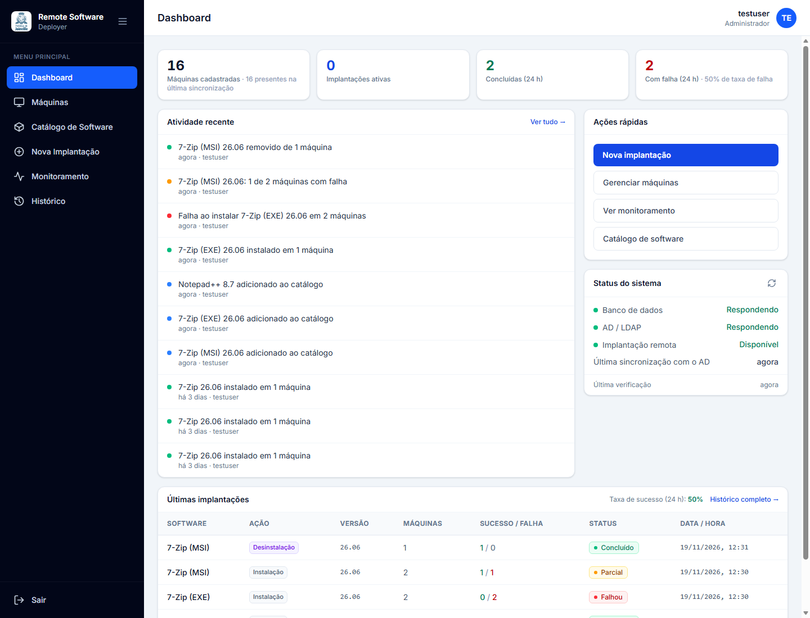
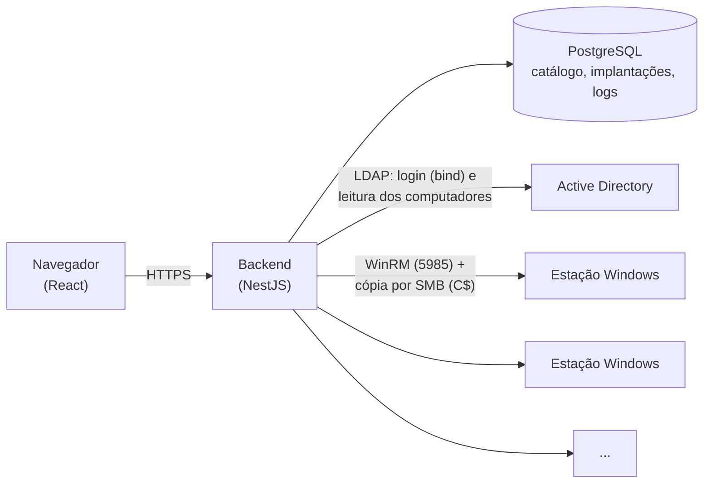
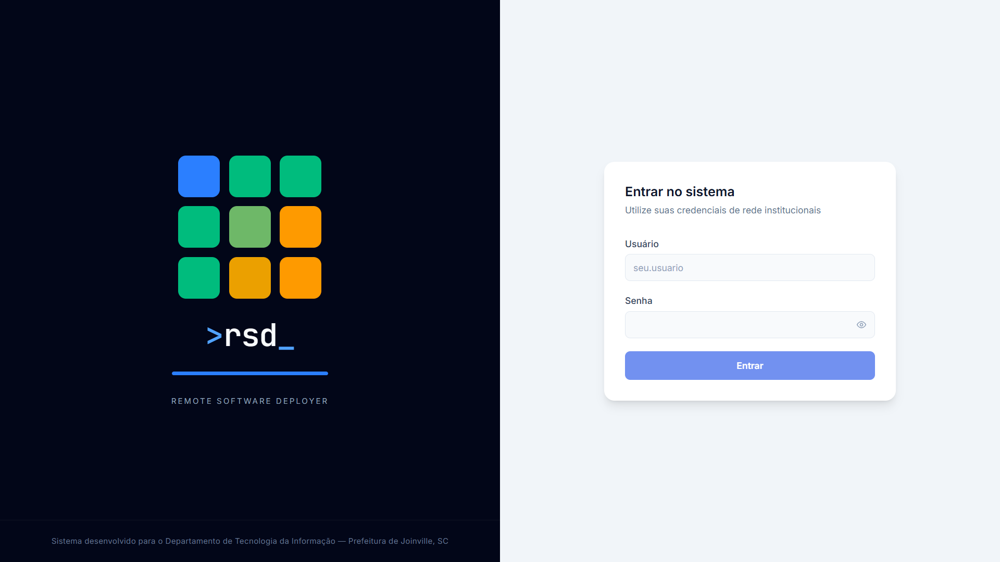
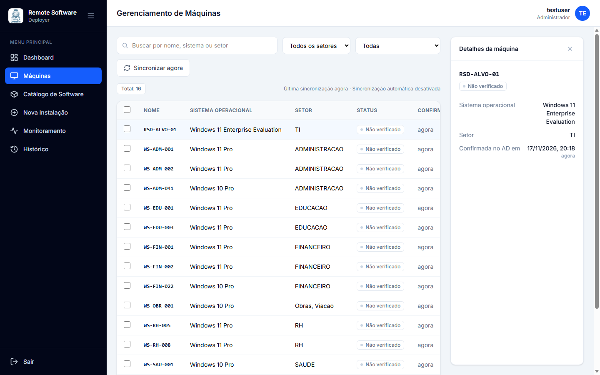
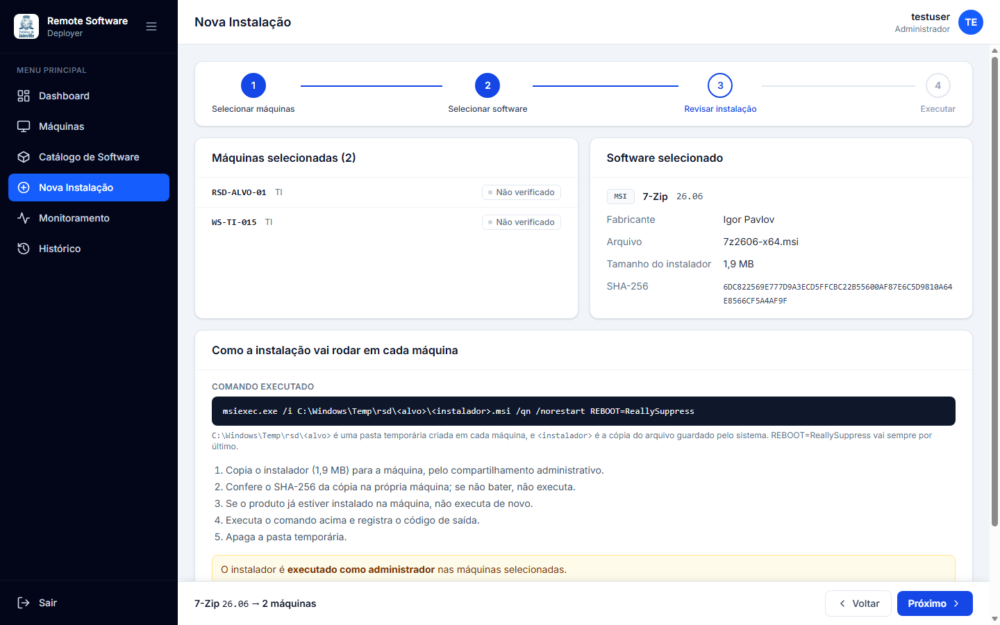
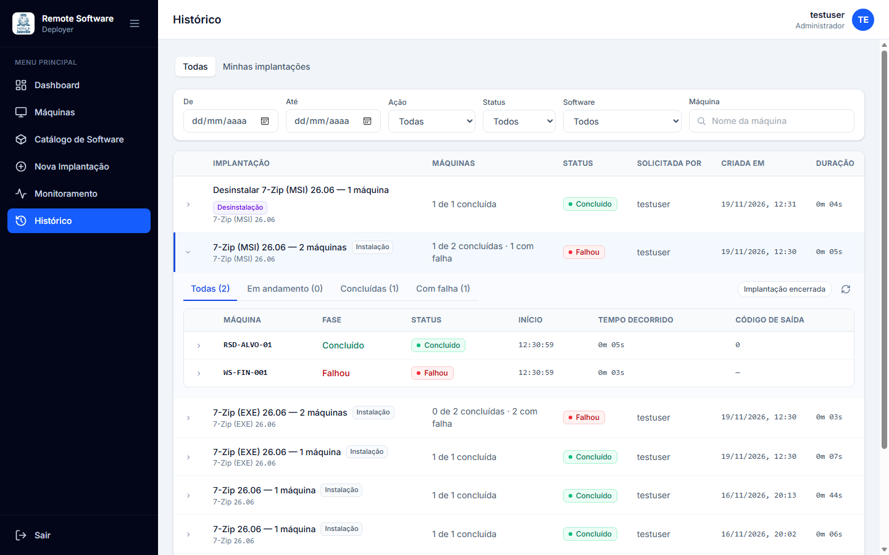
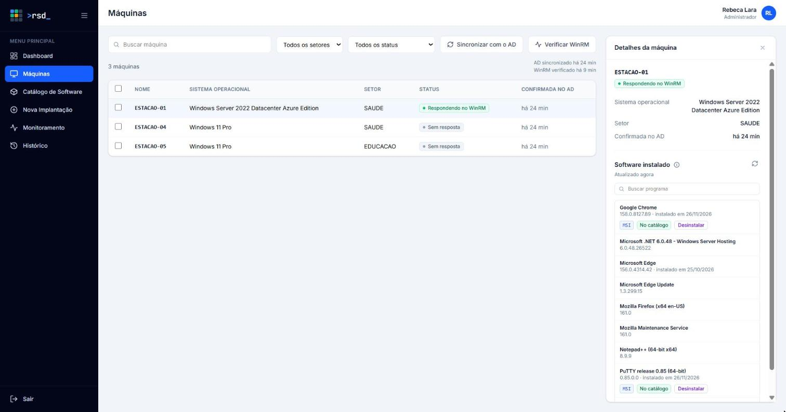
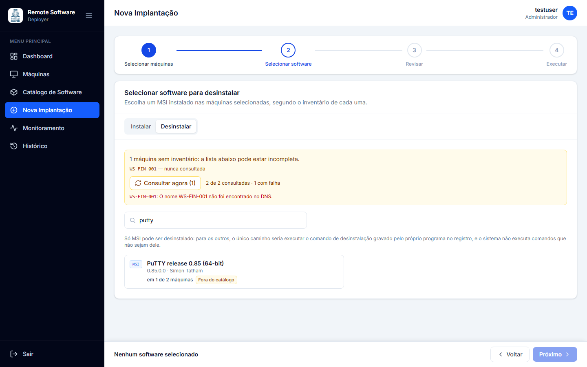

# Remote Software Deployer

Aplicação web para **implantação remota de software em estações Windows**, usando o
Active Directory (AD) como fonte das máquinas e o WinRM/PowerShell para executar a
instalação. Trabalho de Conclusão de Curso em Engenharia de Software, de Rebeca Lara de
Souza.



## O problema

O sistema nasceu de uma necessidade da equipe de TI da Prefeitura Municipal de
Joinville. Hoje, instalar um programa em muitas estações da rede é um trabalho manual,
máquina por máquina, ou depende de ferramentas que não cobrem todos os casos do dia a
dia.

O Remote Software Deployer centraliza esse trabalho num navegador:

1. o operador entra com a **mesma conta de rede** que já usa nos outros sistemas;
2. vê as estações cadastradas no AD, filtra e escolhe as máquinas de destino;
3. escolhe um software de um **catálogo controlado**, com o instalador guardado pelo
   próprio sistema;
4. acompanha a instalação em cada máquina, com o passo atual e o log;
5. consulta depois o histórico de tudo o que foi instalado, por quem e com qual
   resultado;
6. consulta, ao vivo, o software instalado numa máquina.

Nada precisa ser instalado antes nas estações: o sistema usa recursos que o Windows já
tem (WinRM e o compartilhamento administrativo).

## Arquitetura



- O **navegador** fala só com o backend. O token JWT de sessão vale 8 horas.
- O **backend** autentica no AD e sincroniza a lista de computadores (automaticamente e
  pelo botão "Sincronizar agora"). Também guarda os instaladores, executa as
  implantações numa fila (até 10 máquinas em paralelo) e grava o resultado e o log de
  cada máquina.
- Em cada estação, um **script PowerShell fixo** faz sempre a mesma sequência:
  1. copia o instalador;
  2. confere o hash;
  3. verifica se o produto já está instalado;
  4. executa em modo silencioso;
  5. apaga os arquivos temporários.

  Na **desinstalação** (só MSI), o mesmo script confere se o produto está instalado e
  executa `msiexec /x {ProductCode}`, sem copiar nada.
- Para alcançar as estações pelo WinRM, **o backend precisa rodar em Windows, dentro da
  rede das estações.**

### Stack

As versões são fixas de propósito: atualizações automáticas de versão principal já
quebraram o ambiente quatro vezes durante o projeto.

| Camada | Tecnologia |
|---|---|
| Frontend | React `19.3.0`, React Router `7.18.4`, Vite `7.3.6`, Tailwind CSS `4.3.3`, TypeScript `5.8.3` |
| Backend | Node.js `22.x` LTS, NestJS `11`, Prisma `5.22.0`, `ldapjs` 3, TypeScript `5.8.3`, Jest |
| Banco | PostgreSQL `18.6` |
| Diretório | Active Directory (produção) · OpenLDAP `2.4.57` em Docker, imagem `osixia/openldap` (desenvolvimento) |
| Execução remota | Windows PowerShell 5.1, WinRM e SMB |

Restrições conhecidas: Node 24 quebra o Prisma 5, o Prisma 6+ não tem os comandos
clássicos de migração, o NestJS 12 só publica ESM e o TypeScript 7 quebra o `ts-node`.

## Funcionalidades por requisito

| RF | Requisito | Situação |
|---|---|---|
| RF01 | Autenticação | ✅ Login com a conta de rede, por bind LDAP no AD. Perfis ADMIN, OPERATOR e VIEWER. |
| RF02 | Visualizar máquinas | ✅ Lista sincronizada com o AD, com nome, sistema operacional, setor (OU) e data da última confirmação no AD. |
| RF03 | Selecionar máquinas | ✅ Seleção individual e "selecionar todas" respeitando a busca. Até 50 máquinas por implantação. |
| RF04 | Cadastrar softwares | ✅ Catálogo com MSI e EXE e argumentos silenciosos. O instalador é enviado ao sistema, que calcula o SHA-256. Desativar em vez de apagar o que já foi implantado. |
| RF05 | Executar instalação remota | ✅ Fila com até 10 máquinas em paralelo e uma instalação por vez em cada máquina. Validado numa VM de laboratório (ver [Limitações](#limitações-conhecidas)). |
| RF06 | Acompanhar status | ✅ Monitoramento com as implantações em andamento e as encerradas nas últimas 24 h. Cada uma expande na própria linha, com a fase de cada máquina (conectando, copiando, conferindo o hash, instalando…), atualizada a cada 3 s. |
| RF07 | Histórico de instalações | ✅ Implantações encerradas, com filtros por período, ação, status, software, máquina e "Minhas implantações", e paginação. Os filtros ficam no link. |
| RF08 | Inventário de software instalado por máquina | ✅ No painel da máquina: consulta ao vivo pelo WinRM, só de leitura, com nome, versão, fabricante, data de instalação e ProductCode. Os MSI do catálogo aparecem marcados, com atalho para desinstalar. A última consulta fica guardada, com data e quem consultou. |
| RF09 | Registrar resultado | ✅ Status e código de saída por máquina. Os códigos do Windows Installer (1603, 1618…) aparecem com mensagem explicativa. |
| RF10 | Mensagens de sucesso e falha | ✅ Cada falha diz a fase e o motivo (máquina não encontrada, WinRM recusado, acesso negado, hash diferente, tempo esgotado…). |
| RF11 | Pesquisar e filtrar máquinas | ✅ Busca por nome, sistema ou setor; filtro por setor e por presença no AD. |
| RF12 | Detalhes da máquina | ✅ Painel com os dados vindos do AD. IP, CPU e memória não são mostrados porque o AD não os fornece. |
| RF13 | Logs de execução | ✅ Log completo de cada máquina, com hora e nível, dentro da implantação expandida no Monitoramento e no Histórico. |

### Acréscimo fora do RFC: desinstalação remota (só MSI)

Na Nova Implantação, o passo do software tem a escolha **Instalar / Desinstalar**.

- **Como funciona:** a desinstalação usa o mesmo fluxo da instalação (fila, uma ação
  por vez em cada máquina, logs, Monitoramento, Histórico e permissões). Na máquina, o
  comando é sempre `msiexec.exe /x {ProductCode} /qn /norestart REBOOT=ReallySuppress`.
  **Nada é copiado** para a máquina, e nenhum argumento do catálogo é repassado.
- **O que pode ser desinstalado:** em "Desinstalar", o passo 2 lista **o software
  instalado nas máquinas selecionadas**, a partir do inventário guardado de cada uma
  (RF08), com quantas delas têm cada item.
  - **Qualquer MSI pode ser escolhido, inclusive fora do catálogo.**
  - Os itens que não são MSI aparecem desativados.
  - Máquinas sem inventário, ou com inventário de mais de 7 dias, geram um aviso e o
    botão "Consultar agora".
  - Os MSI do catálogo que nenhum inventário encontrou ficam numa seção à parte.
- **De onde vem o ProductCode:**
  - **MSI do catálogo:** é lido pelo servidor do próprio pacote, no envio, com o pacote
    aberto só para leitura.
  - **MSI fora do catálogo:** vem do inventário. A API só aceita um ProductCode que
    apareça no inventário guardado de pelo menos uma das máquinas selecionadas. O nome, a
    versão e o fabricante gravados na implantação vêm desse inventário, no servidor, e
    não do navegador.
- **Produto fora do catálogo:** a revisão mostra um aviso, e o passo 4 exige marcar
  "Confirmo que este produto pode ser removido". Monitoramento, Histórico (com o filtro
  "Fora do catálogo") e Dashboard mostram o nome do produto, e quem pediu continua
  registrado.
- **Produto ausente:** se o produto não estiver instalado na máquina, nada é executado e
  a máquina fica como sucesso, com o aviso "não estava instalado". O mesmo vale para o
  código 1605. Os códigos 0, 3010 e 1641 têm o mesmo tratamento da instalação.
- **Software desativado** no catálogo pode ser desinstalado; instalar continua exigindo
  software ativo.
- **Só MSI tem desinstalação:** para os outros, o único caminho seria executar o comando
  de desinstalação gravado pelo próprio programa no registro (`UninstallString`), e o
  sistema não executa comandos que não sejam dele. O script de inventário nem lê esse
  valor. A tela explica isso no próprio passo.

## Telas

| | |
|---|---|
| **Login** com a conta de rede<br/> | **Máquinas** sincronizadas com o AD, com o painel de detalhes<br/> |
| **Catálogo de Software**: tipo, tamanho e implantações<br/> | **Nova Implantação**, revisão com o comando exato que será executado<br/> |
| **Monitoramento**, com a implantação expandida na própria linha e o log da máquina<br/> | **Histórico** com filtros, uma implantação parcial expandida<br/> |
| **Desinstalação** (só MSI), revisão com o comando exato<br/> | **Software instalado** na máquina (RF08), consultado ao vivo<br/> |
| **Desinstalação pelo inventário**: MSI fora do catálogo, em quantas máquinas está, "Consultar agora"<br/> | |

Os prints foram feitos no ambiente de desenvolvimento, só com dados fictícios: as
máquinas `WS-*` vêm do OpenLDAP local, e a `RSD-ALVO-01` é uma VM de laboratório. O
Monitoramento mostra uma desinstalação real nessa VM, e o Histórico, uma instalação em
que a VM concluiu e a outra máquina, fictícia, falhou por não existir na rede.

## Decisões de segurança

- **Nenhuma senha armazenada.** O login é exclusivamente por bind no AD. O sistema não
  tem cadastro de senha, e a senha digitada é usada só para o bind e descartada. O perfil
  de acesso (ADMIN, OPERATOR ou VIEWER) vem do banco do sistema: só entra quem foi
  cadastrado.
- **Nenhuma execução arbitrária.** O script de instalação é fixo e versionado
  ([`backend/scripts/deploy-target.ps1`](backend/scripts/deploy-target.ps1)), nunca
  montado como texto.
  - Os parâmetros chegam pela entrada padrão, em JSON, e não pela linha de comando, que
    ficaria visível na lista de processos.
  - Os argumentos do catálogo são tokens validados por uma lista de caracteres
    permitidos e passados como parâmetros (`Start-Process -ArgumentList`), nunca por
    `Invoke-Expression` ou `cmd /c`.
  - Não existe o tipo "script".
  - Na desinstalação, o comando também é fixo (`msiexec /x {ProductCode}`). O
    ProductCode vem do próprio pacote MSI, lido no servidor por outro script fixo
    ([`backend/scripts/read-msi-info.ps1`](backend/scripts/read-msi-info.ps1)) que abre
    o MSI só para leitura, ou do inventário guardado das máquinas selecionadas. Nenhum
    argumento do catálogo é usado, e o `UninstallString` do registro nunca é executado.
- **O sistema nunca reinicia as máquinas.** O MSI roda com `/norestart`, e
  `REBOOT=ReallySuppress` é sempre o último argumento, na instalação e na desinstalação. O catálogo recusa `REBOOT` com
  outro valor. Isso foi encontrado na prática: na VM de teste, um `REBOOT=Force` vindo
  do catálogo reiniciou a máquina antes dessa proteção existir.
- **Hash conferido no destino.** O SHA-256 é calculado pelo servidor no envio do
  instalador e conferido na própria estação antes de executar. Se não bater, nada é
  executado e a cópia é apagada.
- **Conta de serviço, nunca a do usuário.** A instalação é executada por uma conta de
  serviço dedicada, administradora local das estações. Em produção, o backend roda como
  serviço do Windows sob uma **conta de serviço gerenciada (gMSA)**, e o WinRM usa a
  identidade do processo via Kerberos, sem senha em arquivo. Quem *pediu* a implantação
  fica registrado.
- **Inventário só de leitura.** A consulta do software instalado (RF08) usa outro script
  fixo ([`backend/scripts/inventory-target.ps1`](backend/scripts/inventory-target.ps1)),
  que só lê as chaves Uninstall do registro, de 64 e 32 bits.
  - Na máquina, nada é copiado e nenhum processo é iniciado.
  - **Nunca `Win32_Product`:** consultar essa classe faz o Windows Installer verificar e
    reparar cada MSI instalado.
  - No teste com a VM, a consulta não gerou nenhum evento do Windows Installer.
- **Permissões por perfil no backend.** Toda rota exige o token JWT. Implantar,
  cancelar, alterar o catálogo e consultar o software instalado ao vivo exigem ADMIN ou
  OPERATOR. O VIEWER só consulta, inclusive a última lista de software guardada.
- **Auditoria.** O sistema registra quem cadastrou e quem alterou cada software, quem
  pediu e quem cancelou cada implantação, e o log de cada máquina.
- **Segredos fora do repositório.** Só os `.env.example` são versionados. Os dados de
  `docker/ldap/` são fictícios e valem apenas no container local.

## Como rodar localmente

### Pré-requisitos

- **Node.js 22.x**, de preferência via `nvm`. Não use o Node 24.
- **Docker** (Docker Desktop no Windows).
- **Git Bash** ou outro shell `sh`, para o script de preparação do LDAP.
- **Windows**, apenas para executar implantações. O resto do sistema funciona em
  qualquer sistema operacional; fora do Windows, a tela mostra a implantação como
  indisponível.

### 1. Banco e AD fictício (Docker)

```bash
# PostgreSQL
docker run --name rsd-db -e POSTGRES_PASSWORD=<escolha-uma-senha> \
  -e POSTGRES_DB=remote_software_deployer -p 5432:5432 -d postgres:18.6

# OpenLDAP simulando o AD (slapd 2.4.57). A imagem é fixada pelo digest porque a tag
# "latest" usada no desenvolvimento não é a mesma build da tag "1.5.0".
docker run --name openldap-dev -e LDAP_ORGANISATION="RSD Dev" -e LDAP_DOMAIN=rsd.local \
  -e LDAP_ADMIN_PASSWORD=<escolha-uma-senha> -p 389:389 -p 636:636 \
  -d osixia/openldap@sha256:3f68751292b43564a2586fc29fb7337573e2dad692b92d4e78e49ad5c22e567b

# Espere alguns segundos o LDAP subir e aplique os dados fictícios
# (conta de serviço de leitura, 16 computadores em 7 setores, usuários de teste e ACL).
# Pode rodar de novo sem duplicar nada.
sh docker/ldap/setup-dev.sh
```

### 2. Backend

```bash
cd backend
npm ci
cp .env.example .env
```

Preencha o `backend/.env`. Para o ambiente local, os valores são:

| Variável | Valor em desenvolvimento |
|---|---|
| `DATABASE_URL` | `postgresql://postgres:<senha-do-rsd-db>@localhost:5432/remote_software_deployer?schema=public` |
| `LDAP_URL` | `ldap://localhost:389` |
| `LDAP_BIND_DN_TEMPLATE` | `uid={{username}},ou=people,dc=rsd,dc=local` |
| `LDAP_SEARCH_BIND_DN` | `uid=svc-rsd-leitura,ou=services,dc=rsd,dc=local` |
| `LDAP_SEARCH_BIND_PASSWORD` | senha fictícia definida em `docker/ldap/services.dev.ldif` |
| `LDAP_COMPUTER_BASE_DN` | `ou=computers,dc=rsd,dc=local` |
| `LDAP_COMPUTER_FILTER` | `(objectClass=device)` |
| `LDAP_COMPUTER_OS_ATTRIBUTE` | `description` |
| `INSTALLER_STORAGE_DIR` | uma pasta **fora do repositório e fora do OneDrive**, entre aspas simples. Exemplo: `'C:\rsd-data\installers'`. O sistema recusa as duas localizações. |
| `JWT_SECRET` | um valor aleatório: `node -e "console.log(require('crypto').randomBytes(32).toString('hex'))"` |

As demais variáveis já têm padrão e estão comentadas no próprio `.env.example`.

Depois, aplique as migrations, cadastre os usuários de teste e suba o backend:

```bash
npm run db:generate
npm run db:deploy

# Usuários de teste: o login vem do LDAP; o perfil, da tabela User do sistema.
docker exec -i rsd-db psql -U postgres -d remote_software_deployer <<'SQL'
INSERT INTO "User" (id, username, role)
VALUES (gen_random_uuid(), 'testuser', 'ADMIN') ON CONFLICT (username) DO NOTHING;
INSERT INTO "User" (id, username, "displayName", role)
VALUES (gen_random_uuid(), 'viewer', 'Usuário Visualizador', 'VIEWER') ON CONFLICT (username) DO NOTHING;
SQL

npm run start:dev      # http://localhost:3000 (GET /health)
```

### 3. Frontend

```bash
cd frontend
npm ci
cp .env.example .env
npm run dev            # http://localhost:5173
```

O Vite repassa as chamadas `/api` para o backend na porta 3000. Usuários de teste (senhas
fictícias, que só valem no container local):

| Usuário | Senha | Perfil |
|---|---|---|
| `testuser` | `senha123` | ADMIN |
| `viewer` | `viewer-dev-123` | VIEWER (somente leitura) |

### 4. Testes

```bash
cd backend
npm test               # mais de 500 testes automatizados
```

### 5. VM de teste (opcional, para implantar de verdade)

Sem uma máquina Windows com WinRM, todo o resto funciona: as implantações em máquinas
fictícias falham com "máquina não encontrada", como devem. Para ver uma instalação real:

1. Crie uma VM Windows no Hyper-V (a de Avaliação serve) e dê a ela um nome que exista
   no LDAP fictício: `rsd-alvo-01` já está em `docker/ldap/computers.dev.ldif`.
2. **Na VM**, como administrador:
   - crie uma conta local administradora (exemplo: `rsd-deploy`);
   - rode `Enable-PSRemoting -Force`;
   - libere no firewall o "Compartilhamento de Arquivos e Impressoras";
   - defina `LocalAccountTokenFilterPolicy = 1` em
     `HKLM\SOFTWARE\Microsoft\Windows\CurrentVersion\Policies\System`. Sem isso, uma
     conta administradora local não usa o `C$` nem o WinRM com privilégio total.
3. **No computador do backend**, como administrador:
   - inicie o serviço WinRM;
   - inclua a VM no `TrustedHosts`: `Set-Item WSMan:\localhost\Client\TrustedHosts -Value <nome-da-VM>`.

   Isso só é necessário porque a VM está fora de domínio. Num domínio, o Kerberos
   dispensa esse passo.
4. No `backend/.env`, preencha `WINRM_USERNAME='<nome-da-VM>\rsd-deploy'` e
   `WINRM_PASSWORD`. Reinicie o backend e clique em "Sincronizar agora" na tela de
   Máquinas.

Recomenda-se um checkpoint da VM limpa: cada teste deixa o software instalado.

## Limitações conhecidas

- **Validação na rede real pendente.** O login (bind) já foi testado no AD real com uma
  conta comum. A leitura e sincronização dos computadores (OUs com acento, mais de 1000
  objetos, conta de serviço da infraestrutura) e a implantação em estações reais dependem
  de acesso à rede da Prefeitura. A implantação foi validada de ponta a ponta numa VM de
  laboratório: MSI, EXE, "já instalado", hash adulterado, tempo esgotado, acesso negado e
  máquina inalcançável.
- **A hospedagem em nuvem é só demonstração.** O WinRM e o SMB das estações não são, e
  não devem ser, expostos à internet. Um servidor em nuvem mostra as telas com o AD
  fictício e a implantação indisponível. Em produção, o backend roda num servidor
  Windows dentro da rede da Prefeitura.
- **Banda:** cada máquina recebe uma cópia do instalador a partir do servidor. Por
  exemplo, 10 máquinas com um instalador de 300 MB somam 3 GB saindo do servidor.
- **Sem estado online/offline das máquinas:** o AD não sabe se a estação está ligada. O
  status só aparece quando a implantação tenta conectar.
- **EXE sem verificação de "já instalado":** só o MSI traz um código de produto
  confiável. Um EXE implantado de novo é executado de novo.
- **Desinstalação só para MSI, e por versão:** cada ProductCode corresponde a uma
  versão do produto. Pelo inventário dá para escolher a versão que está de fato
  instalada. Uma máquina sem inventário, ou com inventário desatualizado, pode ter outra
  versão, e nesse caso o resultado é "não estava instalado".
- **Produto fora do catálogo:** o sistema confere o ProductCode, mas não tem como saber
  se o produto é crítico (antivírus, agente de gerenciamento, biblioteca de outro
  programa). Por isso o aviso e a confirmação obrigatória.
- **Inventário:**
  - **é uma foto:** a lista mostra o momento da consulta, com data e quem consultou;
  - **programas instalados só para um usuário não aparecem:** eles ficam no perfil
    desse usuário, e a sessão WinRM roda com a conta de serviço;
  - **a marcação "no catálogo" vale só para MSI,** pelo ProductCode. Um EXE não tem
    como ser comparado com segurança.
- **Um EXE pode reiniciar a máquina por conta própria.** O sistema controla o reinício
  do MSI, mas não o de um instalador EXE que o force internamente.
- **Fila e agendamento em memória, num único processo.** Com mais de uma instância do
  backend, a trava e a fila precisariam ir para o banco (por exemplo,
  `pg_advisory_lock`).
- Cancelamento só das máquinas ainda na fila: interromper uma instalação em curso
  poderia deixar a máquina em estado inconsistente.

## Trabalhos futuros

- **Busca por software em todas as máquinas** ("em quais máquinas está o X?"): exigiria
  guardar o inventário item a item, e não só a última foto de cada máquina.
- **Desinstalação de EXE:** exigiria descobrir, por família de instalador (Inno Setup,
  NSIS, InstallShield…), o desinstalador e os argumentos silenciosos de cada produto.
- **Agente nas estações:** eliminaria a cópia pelo servidor, que limita a banda, e
  permitiria saber se a máquina está online.
- **Status online/offline e dados de hardware** (IP, CPU, memória) por verificação sob
  demanda.
- **Implantação em ambiente demonstrável** para a banca: nuvem com o AD fictício e a
  implantação ao vivo pelo notebook com a VM.
- **Sessão em cookie `httpOnly`** em vez de `sessionStorage`, e limite de tentativas de
  login quando houver exposição fora da rede interna.
- **Integração contínua** (lint e testes) no GitHub Actions.
